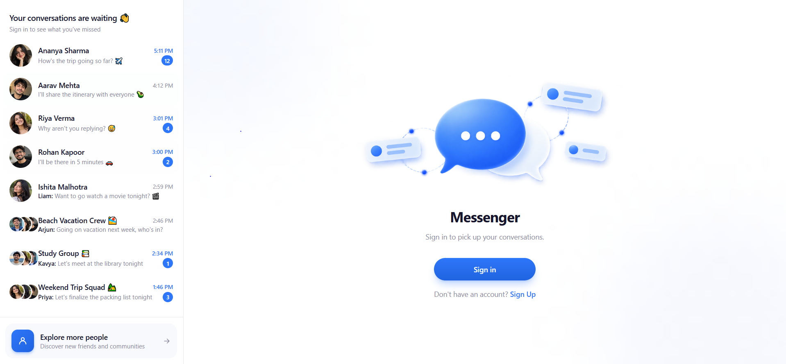
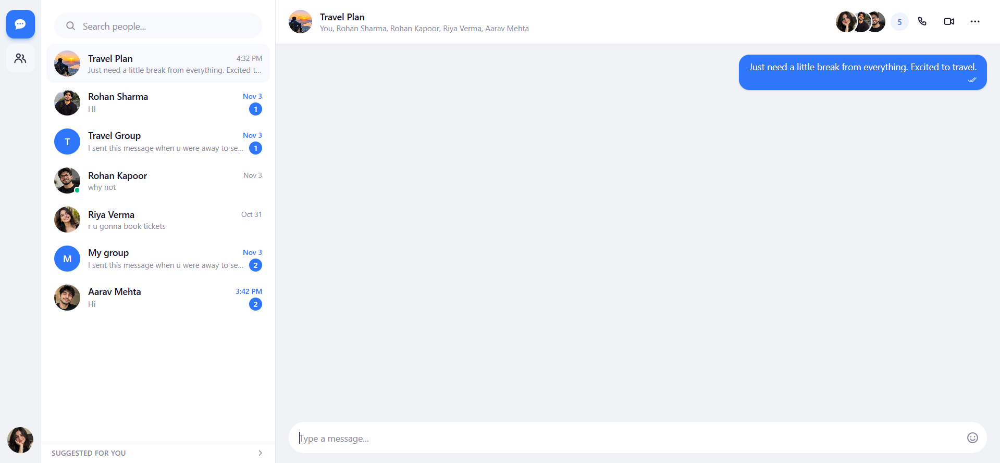

# Realtime Chat

A realtime messaging app with direct and group chats, built on a FastAPI + WebSocket backend and a React frontend.

## Key Features
* **Realtime Messaging:** Instant message delivery over WebSockets, with delivery/read status ticks.
* **Direct & Group Chats:** One-on-one conversations plus group chats with member management, group names, and group photos.
* **Presence & Typing Indicators:** See who's online, last-seen times, and live typing status.
* **Profiles:** Username, display name, status, bio, and profile photo upload.
* **Message Management:** Delete your own messages, with changes reflected for everyone in the chat.

## Login

## Home

